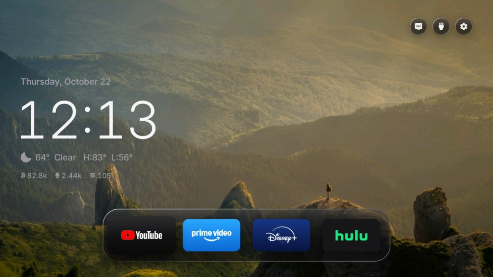

<div align="center">


# Free My TV: Toptro TP2 Projector Edition

**A fork of [Free My TV](https://github.com/simbasjungles/free-my-tv), made specifically for the Toptro TP2 projector.**

Ad-free home screen, projector controls one press away, wallpapers behind a glass shelf, tuned for a 1 GB Android 11 projector.

[Enhancements](#enhancements-in-this-fork) · [Measured](#measured-on-the-projector) · [Build and install](#build-and-install) · [Use it on your projector](#use-it-on-your-projector) · [Going back](#going-back) · [Original project](#the-original-free-my-tv)



<sub>On the projector: today's wallpaper, the night look and the glass shelf. Top right: Projector, HDMI Inputs, Settings.</sub>

</div>

> **This is a fork.** The original app, its design and nearly all of its code are by [simbasjungles](https://github.com/simbasjungles/free-my-tv). This fork only adapts it to one projector. For a TV, use the original.

## The projector

Toptro TP2: Allwinner H713, Android 11, 32-bit ARM userland (armeabi-v7a), 1 GB RAM, 1280×720 UI, stock launcher `com.htc.luminaos`, autofocus service `com.hysd.vafocus`, phone-style Android Settings. Its build reports itself as an `ADT_3`.

## Enhancements in this fork

### In the app

- **Projector controls stay safe.** The stock launcher `com.htc.luminaos` (which opens keystone, focus and picture settings), remote pairing (`com.htc.htcbluetoothremotecontrol`), OTA updates (`com.htc.htcotaupdate`), `com.htc.expandsdk` and the Allwinner setup apps are on the `PROTECTED` list in [`HomeMode.java`](app/src/io/freemytv/HomeMode.java). The switch never turns them off; the stock launcher stays installed as a second home screen. Autofocus (`com.hysd.vafocus`) isn't on any list.
- **Projector debloat.** `com.hotack.screensaversdk` (screensaver SDK, likely ads), `com.htc.eventuploadservice` (telemetry) and `com.htc.hyk_test` (factory test app) are turned off in Free My TV mode. *Original* turns them back on.
- **Projector button.** The first corner button opens the stock launcher (keystone, focus, settings, ScreenCast, HDMI) instead of Live TV, which a projector doesn't have. It appears only when `com.htc.luminaos` is installed, so other devices keep Live TV.
- **No crash on Android Settings.** This projector's Settings doesn't answer `android.settings.SETTINGS`, so the original crashed when opening it. The app now falls back to `com.android.settings/.Settings`, from both the home screen and Free My TV's settings.
- **Glass on Android 9 to 12.** The original's Liquid Glass needs AGSL shaders (Android 13+); older devices got flat fills. Here the glass is a tint, a sheen over the top half and a rim lit from the top left and bottom right, drawn with gradients made once and placed with a matrix: no allocation per frame. Android 13+ still gets the full Liquid Glass.
- **Wallpapers.** With no trending picks (no TMDB key), the home screen shows one of five photos from [`app/assets/wallpapers`](app/assets/wallpapers) instead of a plain gradient: a different one each day, with the night look (white text, smoked glass) so it stays readable. Each is pre-cropped to the screen's 1280×720 (~190 KB) and decoded at 16 bits per pixel (1.8 MB) off the main thread.

- **Configurable for other projectors.** Three new settings in `config.properties`: `projector_app` (what the Projector button opens), `protect_apps` and `debloat_apps`. Two helper scripts: [`tools/inspect-projector.sh`](tools/inspect-projector.sh) reads a projector over adb and suggests those values; [`tools/wallpapers.sh`](tools/wallpapers.sh) turns your photos into wallpapers. See [Use it on your projector](#use-it-on-your-projector).

### On the projector (setup, not code)

- Time zone fixed: automatic time zone had picked `America/Costa_Rica`, an hour off; set to the local zone with automatic detection off.
- Hulu reinstalled from Google Play (newer than the store copy). Disney+ from the projector's own store, since Play lists the current version as incompatible; its Google Play source stamp verifies, so it's the unmodified app.
- VLC 3.7.1, the official 32-bit (`armeabi-v7a`) build from VideoLAN, SHA-256 checked against VideoLAN's published sum.

## Measured on the projector

24 remote presses across the shelf, the corner buttons and the drawer; one warm-up run, then 3 alternating runs of each build (`dumpsys gfxinfo`, `dumpsys meminfo`). No crashes in any run.

| | Janky frames | Median frame | 99th percentile | Memory (PSS) |
|---|---|---|---|---|
| Original | avg 44% | 13–16 ms | 46–73 ms | 53 MB |
| This fork | avg 44% | 13–15 ms | 42–53 ms | 60 MB |

The glass and wallpaper cost nothing measurable in smoothness, and the worst frames got shorter; the extra memory is the wallpaper (in RAM and as a GPU texture). The ~44% janky frames come from the projector's chip, on both builds. A first glass version that redrew the photo inside every pane measured worse (avg 48% janky, +4 MB) and was dropped.

## Build and install

Needs a JDK (17+), the Android SDK command-line tools and adb. On a Mac:

```bash
brew install --cask temurin android-commandlinetools android-platform-tools
sdkmanager "build-tools;36.0.0" "platforms;android-34"
./build.sh            # the first run creates config.properties: set your city (and a TMDB key, optional)
./build.sh
adb connect <projector-ip>:5555
adb install -r FreeMyTV.apk
```

Use build-tools 36 or newer: the `d8` in build-tools 34 crashes on recent JDKs (Java 27: `NullPointerException` in R8). `build.sh` picks the newest installed.

On the projector, open *Free My TV* → *Home Screen* → *Free My TV* and accept the debugging prompt with *Always allow* ticked. Know how to reach keystone and focus first (the Projector button).

Keep `freemytv.keystore` (not in git, created on the first build): updates must be signed with the same key, or Android refuses to install them over the app.

## Use it on your projector

The app works on any Android projector or TV with Android 9 or newer (32- or 64-bit). The Toptro TP2 settings are the defaults; many Allwinner H713 projectors with the same "luminaos" firmware match them as they are. For anything else, spend ten minutes on steps 2 and 3 **before** switching: if the stock home screen holds keystone and focus and isn't protected, switching turns it off and those controls are hard to reach until you choose *Original*.

1. **Turn on debugging** on the projector (Settings → About → press the build number 7 times; then Developer options → USB debugging, or network debugging) and note its IP address.
2. **Inspect it** (changes nothing):
   ```bash
   tools/inspect-projector.sh 192.168.1.50
   ```
   It prints the device, its stock home screen, the vendor apps grouped into *probably keep* and *possible bloat*, and suggested `config.properties` lines.
3. **Set `config.properties`** (`./build.sh` creates it the first time). Review the suggestions; when unsure about an app, protect it rather than turn it off.
4. **Wallpapers (optional):** `tools/wallpapers.sh ~/Pictures/*.jpg` replaces the five in `app/assets/wallpapers`.
5. **Build and install** ([above](#build-and-install)), then switch: *Free My TV* → *Home Screen* → *Free My TV*. Check that the Projector button opens keystone and focus.

### Settings for projectors

All in `config.properties`, applied by `./build.sh` (rebuild and reinstall after a change). The rest of the settings (TMDB key, city, language...) are [the original ones](#settings).

| Setting | What it does | Default |
|---|---|---|
| `projector_app` | The app the Projector button opens, as `package/activity` (usually the stock home screen). Never turned off. `none` shows the Live TV button instead. | `com.htc.luminaos/com.htc.luminaos.activity.MainActivity` |
| `protect_apps` | Extra apps never to turn off, separated by commas: projector controls, remote pairing, updates, setup. | empty |
| `debloat_apps` | Extra apps to turn off in Free My TV mode, separated by commas: ads, telemetry, demos. | empty |

If an app is on both lists, it stays on. The built-in lists (for TCL, Sony, Xiaomi projectors, the Toptro TP2 and others) are in [`HomeMode.java`](app/src/io/freemytv/HomeMode.java) (`BUILT_IN_DEBLOAT`, `PROTECTED`).

### Other customizations

| What | Where |
|---|---|
| Wallpapers (shown when there are no trending picks; one per day) | `tools/wallpapers.sh` → `app/assets/wallpapers` (1280×720 by default; `--size 1920x1080` for 1080p screens, which uses 4 MB instead of 1.8 MB) |
| Apps on the shelf and their order | On the projector: Settings (gear) → Shelf. Default list: `SHELF` in [`HomeApps.java`](app/src/io/freemytv/HomeApps.java) |
| City, temperature unit, language, crypto prices | On the projector in Free My TV's settings, or `config.properties` |
| Trending picks and the photo screensaver | A free TMDB key in `config.properties` ([how](#the-tmdb-key)) |

### What gets saved, and where

| Where | What | In git? |
|---|---|---|
| Your computer: `config.properties` | Your settings: TMDB and Watchmode keys, city coordinates, projector lists | No (private) |
| Your computer: `freemytv.keystore` | The key that signs the APK. **Back it up**: updates must be signed with it, or Android won't install them over the app | No (private) |
| Your computer: `FreeMyTV.apk`, `out/` | The build. The APK contains your TMDB key, so don't share it publicly | No |
| The projector: the app's own storage | Settings changed on the projector (shelf, city, theme), the list of apps it turned off (so *Original* can turn exactly those back on), downloaded pick images | Removed with the app |
| The projector: system | The home screen and screensaver choice, and apps turned off with `pm disable-user` (not uninstalled; their data stays) | n/a |

Nothing is uninstalled and nothing is sent to the developer: the app only talks to Open-Meteo (weather), Binance (prices, if on), TMDB (picks, if a key is set), Watchmode (if a key is set) and the projector's own adb (to switch). See [Privacy](#privacy).

## Going back

*Free My TV* → *Home Screen* → *Original* restores the stock launcher, its screensaver and every app that was turned off. If the home screen crashes 3 times in 5 minutes, the app does this by itself. From a computer: `adb shell cmd package set-home-activity com.htc.luminaos/.activity.MainActivity`.

---

# The original Free My TV

Everything below is the original project's README. It describes the app on Google TV, LG and Samsung TVs and still applies here.

## What you get

- **No ads.** No sponsored rows, banners or autoplaying promos. Not one.
- **Your apps, front and center.** The streaming apps you actually use, on a glass shelf. Pick them and their order right on the TV.
- **Trending, not sponsored.** Three fresh picks every hour from what's trending this week and the latest releases, only from apps you already have. Movies and Shows get their own tabs.
- **Weather and markets, one press away.** The hour-by-hour forecast, sunrise and sunset, and live crypto prices.
- **Light by day, dark by night.** It follows your city's real sunset, the way your phone does.
- **A screensaver to match.** Full-screen photos of the picks with a big glass clock.
- **Fast.** 60 fps, every frame in 16.6 ms, on the TV's own chip. The home screen uses 96 MB of memory instead of 242 MB (−60%).<br><sub>Measured on a 98″ TCL Google TV running Android 14.</sub>
- **Set up on the TV.** Language, your city, temperature, theme, the weather and prices cards, which coins, and the apps on the shelf, in Free My TV's own settings.
- **Safe.** No root. Nothing is uninstalled. One button brings back the factory home screen.

## Install

About ten minutes. You need a Google TV or Android TV (Android 9 or newer) and a computer on the same Wi-Fi.

### The easy way: an AI assistant

1. **On the TV**, turn on developer mode: Settings → System → About → press *Android TV OS build* 7 times. Then Settings → System → Developer options → turn on **USB debugging**. Write down the TV's IP address (Settings → Network & Internet).
2. **On your computer**, open an AI coding assistant ([Claude Code](https://claude.com/claude-code), Codex or Antigravity) and say:
   > Install Free My TV (github.com/simbasjungles/free-my-tv) on my TV at 192.168.1.50. I live in Lisbon.

   It downloads the code, installs the tools it needs, builds the app and puts it on your TV, and asks before anything important. Swap in your TV's IP and your city.
3. **On the TV**, open *Free My TV* → *Home Screen* → *Free My TV*, and accept the debugging prompt (tick *Always allow*).

### The manual way

1. **On the TV**, do step 1 above.
2. **Tools:** a JDK (17+), the Android SDK command-line tools (build-tools 34, platform android-34) and adb. On a Mac:
   ```bash
   brew install --cask temurin android-commandlinetools android-platform-tools
   sdkmanager "build-tools;34.0.0" "platforms;android-34"
   ```
   On Linux, get OpenJDK 17, Android's command-line tools and adb from your package manager, then run the same `sdkmanager` line. On Windows, use Git Bash (which Claude Code uses there) or WSL.
3. **Build:**
   ```bash
   ./build.sh
   ```
   The first run creates `config.properties`. Set your city and your [TMDB key](#the-tmdb-key) there, then run it again.
4. **Install:**
   ```bash
   adb connect 192.168.1.50:5555
   adb install -r FreeMyTV.apk
   ```
   On TCL TVs, also let it run in the background (TCL blocks it by default, and the switch never starts):
   ```bash
   adb shell "appops set io.freemytv AUTO_START allow || appops set io.freemytv APP_AUTO_START allow"
   ```
5. **On the TV**, open *Free My TV* → *Home Screen* → *Free My TV*.

## LG TVs (webOS)

The same home screen as an LG app: the picks, the glass shelf with your apps, the drawer with inputs, weather and prices, day and night, Home Settings and the shelf editor. It installs through LG's own Developer Mode, with nothing rooted or changed on the TV. LG's home screen stays where it is, and Free My TV is one press of a number key away.

You need an LG TV (webOS 3 or newer) and a computer on the same Wi-Fi, with Python 3.

1. **On the TV**, open the LG Content Store and install **Developer Mode**. Sign in with a free [LG developer account](https://webostv.developer.lge.com), turn on **Dev Mode Status** (the TV restarts), then turn on **Key Server**. Write down the IP address and the passphrase it shows.
2. **On your computer**, get the code and build. `config.properties` works as for Google TV (your city, your [TMDB key](#the-tmdb-key)):
   ```bash
   git clone https://github.com/simbasjungles/free-my-tv && cd free-my-tv
   python3 webos/build.py
   ```
3. **Install.** The first time, it asks for the TV's passphrase; updates don't:
   ```bash
   python3 webos/install.py 192.168.1.50
   ```
4. **On the TV**, while Free My TV is open, hold a number key on the remote. From then on, that key opens it from anywhere.

With an AI assistant, say *"Install Free My TV (github.com/simbasjungles/free-my-tv) on my LG TV at 192.168.1.50. I live in Lisbon."* It builds the app and hands you the install command, so you type the passphrase yourself.

Developer Mode lasts about 40 days: open the Developer Mode app now and then and press **EXTEND**. To remove Free My TV, run `python3 webos/install.py 192.168.1.50 --uninstall`.

## Samsung TVs (Tizen)

The same home screen as a Samsung app, with everything the LG one has: the picks, the shelf, the drawer with the inputs, the weather and the prices, day and night, and its own settings. It installs through Samsung's own Developer Mode, with nothing rooted or changed on the TV, and Samsung's home screen stays where it is.

You need a Samsung TV from 2017 or newer (Tizen 3+) and a computer on the same Wi-Fi.

1. **On the TV**, open **Apps** and type `1 2 3 4 5` on the remote. Turn **Developer mode** on, type your computer's IP address in **Host PC IP**, and restart the TV.
2. **On your computer**, download [TizenBrew Installer](https://github.com/reisxd/TizenBrewInstaller/releases/latest), the community's installer for Samsung TVs, open it and connect to your TV.
3. **Install from GitHub:** type `simbasjungles/free-my-tv`. On 2023 and newer TVs it asks you to sign in to your Samsung account once, to sign the app for your TV.
4. **Straight to it:** in the TV's settings, under Start Screen Options, turn on **Autorun Last App**: the TV turns on into Free My TV.

This build takes your city from the TV's time zone. For your exact city and the trending picks, build it with your own `config.properties` and [TMDB key](#the-tmdb-key): open the folder in Claude Code and say *"Install Free My TV on my Samsung TV at 192.168.1.50. I live in Lisbon."* It sets up Samsung's tools, and on 2023 and newer TVs you sign in to your Samsung account in the browser to make the certificate. Your signed build installs with `python3 tizen/install.py 192.168.1.50`, which needs only Python: no Tizen Studio, and no Rosetta on Apple Silicon Macs.

## Settings

The first values come from `config.properties`, created by the first build (Google TV, LG and Samsung use the same file). Most of them can also be changed on the TV, in *Free My TV* → *Home Settings*, and the TV's choice wins:

| Key | What it does | Default |
|---|---|---|
| `tmdb_key` | Your free TMDB key, for the picks | empty |
| `tmdb_region` | Your country (two letters): which titles are on which app | `US` |
| `watchmode_key` | Optional, free [Watchmode](https://api.watchmode.com/) key: a pick opens the title's page in its app | empty |
| `latitude`, `longitude` | Your city, for the weather and the sunset | New York |
| `city` | The name on the weather card | `Weather` |
| `hide_animation` | Leave cartoons and anime out of the picks | `false` |
| `language` | `auto` (follows the TV), `en`, `es`, `pt`, `ru` or `de` | `auto` |
| `show_crypto` | Show Binance crypto prices on home and screensaver | `true` |
| `currency` | Crypto prices in `USD`, `EUR`, `BRL`… | `USD` |
| `temperature` | `C`, `F` or `auto` | `auto` |
| `disable_assistant` | Also turn off Google Assistant | `false` |

Changed something? Run `./build.sh` and install again. Keep `freemytv.keystore`: updates are signed with it.

### The TMDB key

Free, and it takes two minutes: create an account at [themoviedb.org](https://www.themoviedb.org/signup), then open [Settings → API](https://www.themoviedb.org/settings/api) and request a developer key. Paste the *API Read Access Token* (or the *API Key*) after `tmdb_key=`. It's your key: `config.properties` stays out of git.

### Opening a title, not just its app (optional)

With a free [Watchmode](https://api.watchmode.com/) key (`watchmode_key=` in `config.properties`), a pick opens its own page in the streaming app instead of the app's home. The free plan (2,500 credits a month) is enough: each title costs two requests the first time and is remembered after that. It works where the app takes the title's web address (tested: Prime Video and JioHotstar); where it doesn't, the pick just opens the app, as without a key.

## Going back

On the TV: *Free My TV* → *Home Screen* → *Original*. The factory home screen, screensaver and every app come back exactly as they were. If the new home screen ever crashes three times in five minutes, it switches back by itself.

To remove it for good, switch to *Original* first, then uninstall *Free My TV* (Settings → Apps). Uninstalled it while it was on? Install it again and pick *Original*: the list of what it turned off is kept in the TV's settings, so everything comes back.

## What it changes

- It becomes the home screen and the screensaver.
- It turns off, without uninstalling:
  - the stock home screen and screensaver;
  - Google TV's recovery home, Play Games and YouTube Music;
  - on TCL TVs, the TCL Channel, messages, store demo, hotel menu, manuals, mirroring and logging apps;
  - on Philco TVs, AI PONT (promo channels and app downloads) and the manual;
  - on Multilaser TVs, Anoki's screen-content recognition (ACR), the store demo and the manual;
  - on KTC-made TVs (NextStar), Anoki's screen-content recognition (ACR), the store demo and the manual;
  - Google Assistant, only with `disable_assistant=true`.
- On TCL TVs, the remote's Netflix, YouTube and Prime buttons keep working through a small accessibility service that only reads those buttons. Pick what each one opens in *Free My TV* → *Remote Buttons*; *Original* turns the service off. On Vestel-made TVs (F&U and other store brands) and Xiaomi (Formovie) projectors the same goes for the Netflix button, and on KTC-made TVs (NextStar) for the Tabii button. On Sony TVs, the BRAVIA CORE, Netflix, Disney+, Prime Video, YouTube and Crunchyroll buttons can each open the app you pick, or keep Sony's default.
- Picture, sound, inputs, remote pairing, Google services and the Play Store are on a protected list, checked before every change.
- Apps that saved a Wi-Fi network are never turned off, since Android would erase the network. If the TV's first setup saved yours, the switch asks you to forget the network and connect again in Settings first (saved networks out of range don't show there; Claude Code can remove them).

## Any TV

Free My TV runs on Google TV and Android TV: TCL, Sony, Hisense, Philips, Xiaomi, Vestel-made TVs (F&U), KTC-made TVs (NextStar) and more, plus streamers like Chromecast with Google TV, the Google TV Streamer, onn 4K and NVIDIA Shield. And on [LG](#lg-tvs-webos) and [Samsung](#samsung-tvs-tizen) TVs, as an app.

**Any other TV:** plug a Google TV streamer into HDMI and free that one. Same steps, same home screen.

**A different brand or model:** ask Claude. Free My TV is made to be adapted by AI. Open the folder in Claude Code and say *"set it up for my Sony"*: it reads your TV, finds its home screen and its promo apps, updates the lists below and walks you through a test. [CLAUDE.md](CLAUDE.md) tells it how.

| What | Where |
|---|---|
| Apps to turn off | `DEBLOAT` in [`HomeMode.java`](app/src/io/freemytv/HomeMode.java) |
| Apps never to touch | `PROTECTED` in the same file |
| Apps on the shelf | `SHELF` in [`HomeApps.java`](app/src/io/freemytv/HomeApps.java) |
| Your brand's live TV app | `LIVE_TV_APPS` in the same file |

## Make it yours

It's your code, and Claude Code finds its way around it. Try:

- *"Add Crunchyroll to the shelf."*
- *"Show the prices in euros."*
- *"Add Spanish."*
- *"Switch to the night look an hour after sunset."*

## How it works

- **A plain Android app, no Gradle, no libraries.** [`build.sh`](build.sh) runs aapt2 → javac → d8 → zipalign → apksigner and makes a 2 MB APK.
- **It uses the TV's own ADB, from inside the TV.** The app connects to `127.0.0.1:5555` with its own key (that's the *Allow USB debugging?* prompt) and runs the same commands you would: `cmd package set-home-activity`, `settings put secure screensaver_components`, `pm disable-user`. Nothing listens to the network.
- **Drawn by hand on one Canvas**, with Android 13 shaders for the frosted glass and the sky (plain fills on Android 9 to 12, with lighter shadows and no GPU layers on 9 to 11 for their older GPUs).
- **A safety net.** A watchdog in a separate process brings back the stock home screen after three crashes in five minutes, and a boot check keeps your choice after TV updates.
- **On LG and Samsung, the same design in plain HTML, CSS and JavaScript** ([`web/`](web)), written for the Chromium of older TVs, with no frameworks. [`webos/build.py`](webos/build.py) packs it with `config.properties` into an `.ipk` without LG's tools, and [`webos/install.py`](webos/install.py) installs it through Developer Mode; on LG it lists and opens apps through the TV's own service bus (Luna), as LG's launcher does. [`tizen/build.py`](tizen/build.py) packs the same app into a Samsung `.wgt`, which uses Tizen's web APIs for the apps and the inputs. To preview it on a computer: `python3 webos/build.py --preview`, then open `out/webos/index.html` (a stand-in lists sample apps).
- **Data** from TMDB (trending titles, new releases and which app streams what in your country), Open-Meteo (forecast, sunrise and sunset), and optionally Binance (24-hour prices when `show_crypto=true`).

| File | What it is |
|---|---|
| [`HomeView.java`](app/src/io/freemytv/HomeView.java) | The home screen |
| [`HomeMode.java`](app/src/io/freemytv/HomeMode.java) | Switching between Free My TV and Original |
| [`Adb.java`](app/src/io/freemytv/Adb.java) | The TV's own ADB, from inside the TV |
| [`Recs.java`](app/src/io/freemytv/Recs.java) | The picks (TMDB) |
| [`HomeData.java`](app/src/io/freemytv/HomeData.java) | Weather and prices |
| [`HomeApps.java`](app/src/io/freemytv/HomeApps.java) | The shelf, inputs and All Apps |
| [`DreamView.java`](app/src/io/freemytv/DreamView.java) | The screensaver |
| [`SettingsActivity.java`](app/src/io/freemytv/SettingsActivity.java) | The settings screen (the app's icon) |
| [`Prefs.java`](app/src/io/freemytv/Prefs.java) | Settings changed on the TV |
| [`RemoteKeys.java`](app/src/io/freemytv/RemoteKeys.java) | The TCL remote's app buttons |
| [`Watchdog.java`](app/src/io/freemytv/Watchdog.java) | The safety net |
| [`web/home.js`](web/home.js) | The home screen on LG TVs |
| [`web/tv.js`](web/tv.js) | The TV's apps and inputs, on LG and Samsung |
| [`webos/build.py`](webos/build.py), [`webos/install.py`](webos/install.py) | The LG app package and its install |
| [`tizen/build.py`](tizen/build.py) | The Samsung app package |

The website ([freemytv.io](https://freemytv.io)) is in [`docs/`](docs): plain HTML, CSS and JS on GitHub Pages.

## Privacy

No accounts, no analytics, no tracking. The app talks to TMDB, Open-Meteo (with the coordinates you set, or your time zone's main city), and Binance only when `show_crypto=true`, and Watchmode only when you set a `watchmode_key`. Your settings stay on your computer and your TV.

## Credits

- Built with [Claude Code](https://claude.com/claude-code).
- The LG version builds on what [@danielthejoker18](https://github.com/danielthejoker18) found in [FreeMyTvWebOS](https://github.com/danielthejoker18/FreeMyTvWebOS) (MIT): installing through Developer Mode and opening apps through the TV's service bus.
- On Samsung TVs it installs with [TizenBrew Installer](https://github.com/reisxd/TizenBrewInstaller) by [@reisxd](https://github.com/reisxd).
- This product uses the TMDB API but is not endorsed or certified by [TMDB](https://www.themoviedb.org/).
- Links to the titles in the streaming apps by [Watchmode](https://api.watchmode.com/).
- Weather data by [Open-Meteo.com](https://open-meteo.com/) (CC BY 4.0). Prices from the [Binance](https://www.binance.com/) public API.
- Icons: [Material Symbols](https://fonts.google.com/icons) (Apache 2.0). Font: [Inter](https://rsms.me/inter/) (SIL OFL 1.1). Coin logos: [cryptocurrency-icons](https://github.com/spothq/cryptocurrency-icons) (CC0). Samsung app logos: [Simple Icons](https://simpleicons.org) (CC0).
- Not affiliated with Google, TCL, LG, Samsung or any streaming service. App names and logos belong to their owners.

## License

[MIT](LICENSE). Fork it, change it, ship it.
